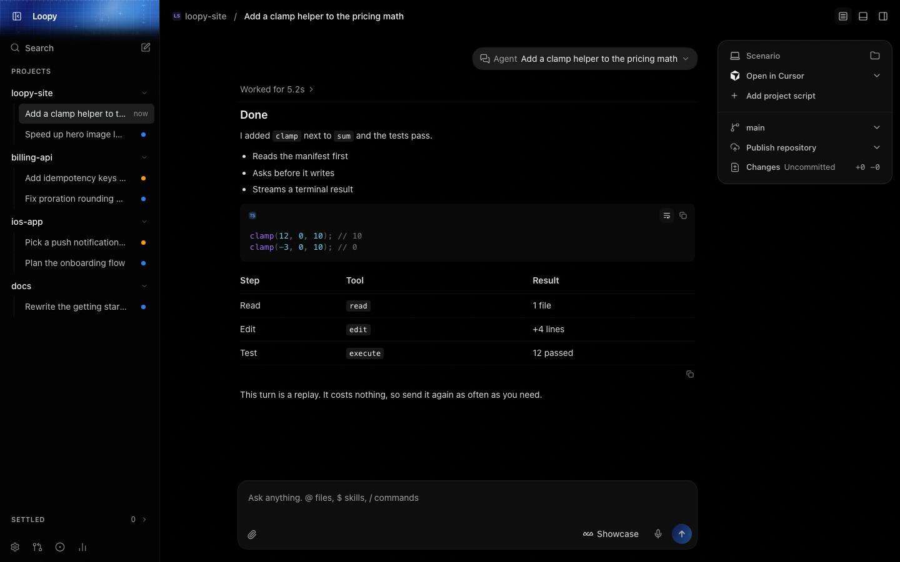

  

<h1 align="center">Loopy</h1>

The calm control room for your coding agents.

  <a href="https://github.com/aaf1007/loopy/releases/latest"><strong>Download for macOS</strong></a> ·
  <a href="./docs/README.md">Docs</a> ·
  <a href="https://github.com/aaf1007/loopy/issues">Issues</a>

  

Loopy brings Codex, Claude Code, and other coding agents into one workspace. Run them on your own machine with the accounts you already use, follow their work across projects, and review changes before you ship.

## What you can do

- **Work across agents.** Use Codex, Claude Code, Cursor, OpenCode, Grok Build, Antigravity, Kiro, Pi, Muse Code, fx, or an [ACP agent](./docs/user/providers-acp.md).
- **Keep tasks organized.** Group threads by project and give each task its own Git worktree when you want to keep changes separate.
- **Review and ship.** Inspect diffs, commit changes, push branches, and open pull requests from the workspace.
- **Connect to another machine.** Pair with a reachable host over your local network or a private network such as Tailscale. See [direct pairing](./docs/user/remote-access.md#pair-over-a-lan-or-private-network).

## Get started

1. Download the Apple Silicon DMG from [Loopy Releases](https://github.com/aaf1007/loopy/releases/latest) and move Loopy into Applications. The release notes cover opening the app the first time.
2. Install and sign in to at least one supported agent. See the setup guides for [Codex](./docs/user/providers-codex.md) and [Claude Code](./docs/user/providers-claude.md).
3. Open Loopy, add a project, and start a thread.

## Development

- [Build and run from source](./docs/operations/00_development.md#first-checkout)
- [Architecture overview](./docs/internals/01_architecture.md)
- [Loopy release runbook](./docs/operations/06_loopy-release.md)
- [Report a bug](https://github.com/aaf1007/loopy/issues/new)

## License

Loopy is an open-source fork of [T3 Code](https://github.com/pingdotgg/t3code), licensed under [MIT](./LICENSE).
